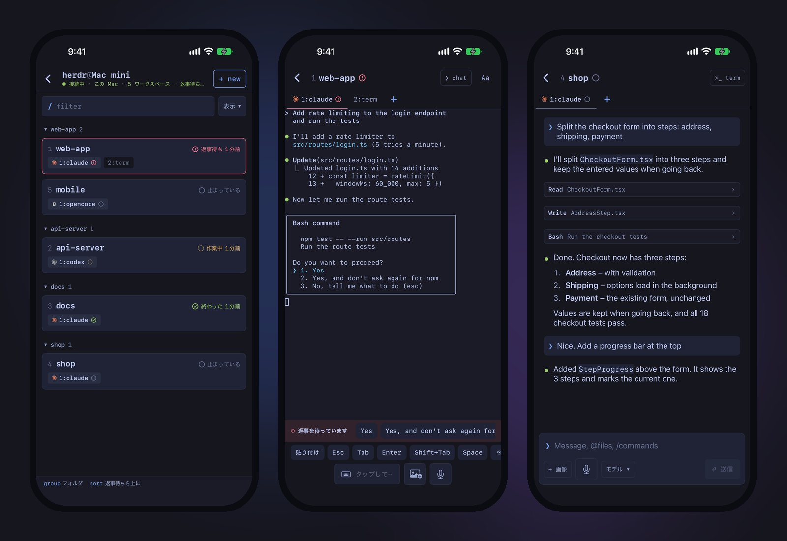
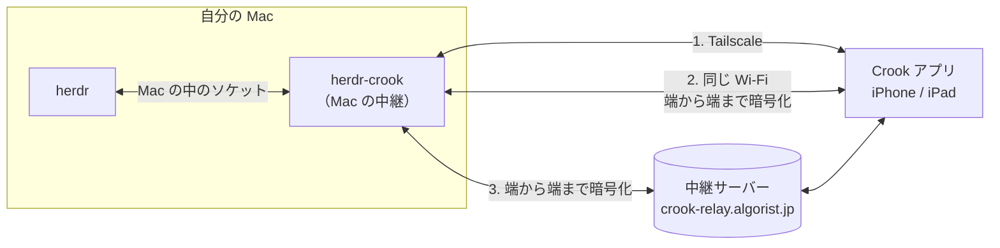

<div align="center">


# herdr-crook

**[Crook](https://crook.algorist.jp/ja) のための Herdr プラグイン。Mac の AI コーディングエージェントを iPhone と iPad で見て、ワンタップで答えられます。**

[](https://github.com/algorist-dev/herdr-crook/releases)
[](LICENSE)
[](https://herdr.dev)
[](https://nodejs.org)
[](#要るもの)
[](https://crook.algorist.jp/ja)

[English](README.md) | 日本語

</div>

> [!IMPORTANT]
> このプラグインは、iPhone・iPad アプリ **Crook for Herdr** の Mac 側です。使うにはアプリが要ります。
> アプリはいま App Store の審査待ちです（**近日公開**）。詳しくは [crook.algorist.jp](https://crook.algorist.jp/ja)。

<p align="center"></p>

## できること

- **返事待ちが、いちばん上に**：Mac の Herdr のエージェントを、返事待ち → 終わった → 作業中 → 待機中の順に、Herdr と同じ記号（● ◐ ✓ ○）で並べます。
- **ワンタップで答える**：エージェントが許可を求めると、選択肢がアプリのボタンになります。
- **本物のターミナル**：ペインのターミナルを色つきでそのまま。esc・tab・矢印・ctrl・^C のキーの列つき。
- **話す・打つ・画像を送る**：会話をチャットの形で読み、次の指示を文字か声で。写真と `@ファイル` も。
- **使用量がひと目で**：コンテキスト・トークン・5 時間と週の上限・費用。
- **アカウントも SSH の設定も不要**：1 回だけの QR でつなぎます。つなぐのは自分の Mac だけです。

Claude Code・Codex・OpenCode・GitHub Copilot CLI と、Herdr のふつうのターミナルのペインに対応しています。

## はじめかた

1. Mac で**プラグインを入れる**：

   ```bash
   herdr plugin install algorist-dev/herdr-crook
   ```

2. **Herdr を開き直す**（`herdr server stop` のあと `herdr`）。はじめての起動で、プラグインが Mac の中継（launchd の `jp.algorist.crook`）を動かし、`prefix+m` の設定を入れます。
3. **つなぐ**：Herdr で `prefix` のあと `m`（ふつうは `ctrl+b`・`m`）を押し、出た QR を Crook で読みます。QR は 1 回だけ・5 分で使えなくなります。

## 要るもの

- [Herdr](https://herdr.dev) 0.9 以上の Mac
- Node.js 23.6 以上（TypeScript をそのまま動かします。ビルドは要りません）
- iOS 18 以上の iPhone か iPad と、Crook のアプリ（App Store、近日公開）

> [!TIP]
> **おすすめ：[Tailscale](https://tailscale.com/download)（個人は無料）**。Mac と iPhone・iPad の両方に入れ、同じアカウントでログインします。
> - 外出先からも、速く直接つながる
> - 時間と通信量の上限が無い
> - 中継サーバーを通らない
>
> Tailscale が無いときは、家では同じ Wi‑Fi でつながり、外では端から端まで暗号化した中継サーバーを通ります（Mac 1 台につき 1 日 120 分・200 MB まで）。試すには十分ですが、毎日外で使うなら Tailscale を入れてください。（Tailscale は別の会社のサービスで、Crook とは関係ありません）

## しくみ



プラグインは Herdr の Mac の中のソケットからエージェントを読み、Mac で小さな中継を動かします。アプリは次の順につなぎます。

1. **Tailscale**：中継は Tailscale の IP で受け、同じ Tailscale のユーザーの端末だけを通します。
2. **同じ Wi‑Fi**：QR で受け取った Mac の鍵で、端から端まで暗号化します。
3. **中継サーバー**（`crook-relay.algorist.jp`、Algorist が Cloudflare で動かしています）：中身を読めない暗号化したものを通すだけです。無料で、Mac 1 台につき 1 日 120 分・200 MB まで（00:00 UTC に戻ります）。

アプリは App Store で配り、中継サーバーは Algorist が動かしています。このリポジトリにあるのは Mac のプラグインだけです。

## プライバシーとセキュリティ

| どこへ | 何が |
|---|---|
| **つないだ自分の端末だけ** | エージェントの一覧と状態、開いたペインのターミナル、開いたエージェントの会話、`@` の候補のファイル名、使用量、Herdr のテーマ、（QR の中の）Mac の Tailscale・同じネットワークのアドレス |
| **中継サーバー** | 中身を読めない暗号化したものだけ。使いすぎを防ぐための Mac ごとのその日の量と、IP アドレスごとのつなぎの回数。何も残しません |
| **Algorist** | 何も届きません。アカウント・アクセス解析・広告・追跡はありません（プラグインにもアプリにも） |

- **つなぎ方**：合言葉は 1 回だけ・5 分で使えなくなります。端末の鍵はハッシュだけを残します（`~/.config/crook/devices.json`、0600）。中継は `0.0.0.0` では受けません。
- **暗号化**：同じ Wi‑Fi と中継サーバーでは、QR の Mac の鍵で端から端まで暗号化します（X25519 ＋ ChaCha20‑Poly1305）。
- **写真**：送った写真は、エージェントが読めるように `~/.config/crook/uploads`（0600）に置き、1 週間で消します。

詳しくは[プライバシーポリシー](https://crook.algorist.jp/ja/privacy)。弱いところを見つけたら [SECURITY.md](SECURITY.md) のとおり知らせてください。

## 通知

アプリを開いて Mac につながっているあいだは、返事待ちになった・終わったらアプリが知らせます。アプリが裏にいるときの通知は、次の版で入れる予定です（Mac に Apple の鍵を入れなくても、中継サーバーから届く形）。

## コマンド

プラグインのフォルダで動かします（場所は `herdr plugin list` で分かります）。

```bash
node src/cli.ts status     # 中継が動いているか
node src/cli.ts devices    # つないだ端末
node src/cli.ts revoke ID  # 端末を消す
node src/cli.ts uninstall  # 中継を止め、launchd の設定を消す
```

Claude Code を使うなら（入れなくても使えます）：`node src/cli.ts statusline-install` で `~/.claude/statusline.sh` に 1 行足すと（元は `.bak-crook` に残します）、アプリで正確なコンテキストの割合と 5 時間・週の上限が見られます。

| 環境変数 | はたらき |
|---|---|
| `CROOK_RELAY_SERVER=off` | 中継サーバーを使わない（Tailscale と同じ Wi‑Fi だけ） |

## 困ったとき

<details>
<summary><b>アプリが Mac につながらない</b></summary>

Herdr が動いていて、`node src/cli.ts status` で中継が動いているか確かめてください。アプリは Tailscale → 同じ Wi‑Fi → 中継サーバーの順に試します。中継サーバーができる前につないだ Mac は、QR を 1 回読み直すと Mac の鍵が入ります。
</details>

<details>
<summary><b>QR が読めない</b></summary>

QR は 1 回だけ・5 分で使えなくなります。もう一度 `prefix` のあと `m` を押してください。
</details>

<details>
<summary><b>入れたのに動かない</b></summary>

`node --version` で Node.js 23.6 以上か確かめてください（古いと、入れるときに止まって知らせます）。そのあと Herdr を開き直します（`herdr server stop` のあと `herdr`）。
</details>

<details>
<summary><b>全部消したい</b></summary>

`node src/cli.ts uninstall` のあと `herdr plugin uninstall algorist.crook`。つないだ記録は `~/.config/crook` にあるので、消すならこのフォルダも消してください。
</details>

ほかの質問：[crook.algorist.jp/ja/support](https://crook.algorist.jp/ja/support) · [issue を開く](https://github.com/algorist-dev/herdr-crook/issues/new/choose)

## よくある質問

**無料ですか**：はい。プラグインは MIT、アプリも無料で、アカウントもアプリ内課金もありません。

**Herdr の開発者が作ったものですか**：いいえ。Crook は [Algorist](https://algorist.jp/) が作っていて、Herdr のプロジェクトとは関係ありません。

**Algorist にコードや会話が見えますか**：見えません。データは自分の Mac と、つないだ端末のあいだだけを行き来します。中継サーバーを通るときも端から端まで暗号化するので、中継サーバーは読めません。

**Tailscale は要りますか**：必須ではありませんが、おすすめします。Tailscale（個人は無料）があれば、外からも直接つながり、時間と通信量の上限がありません。無いときは、家では同じ Wi‑Fi、外では端から端まで暗号化した中継サーバーを通ります（Mac 1 台につき 1 日 120 分・200 MB まで）。

**外出先からつながりますか**：つながります。Tailscale（おすすめ）なら直接、上限なしで。無いときは中継サーバーを通り、1 日の上限の中で使えます。

**Linux や Windows で使えますか**：まだです。プラグインは launchd を使い、macOS でだけ確かめています。

## 開発

```bash
npm ci
npm test
npm run typecheck
```

[CONTRIBUTING.md](CONTRIBUTING.md) を見てください。変わったことは [CHANGELOG.md](CHANGELOG.md) にあります。

## ライセンス

[MIT](LICENSE) © Algorist

## 開発の応援

Crook は無料です。役に立ったら、[Buy Me a Coffee](https://buymeacoffee.com/algorist) で開発を応援できます。
