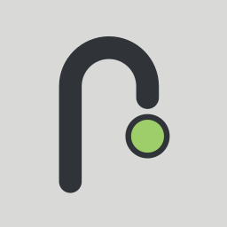
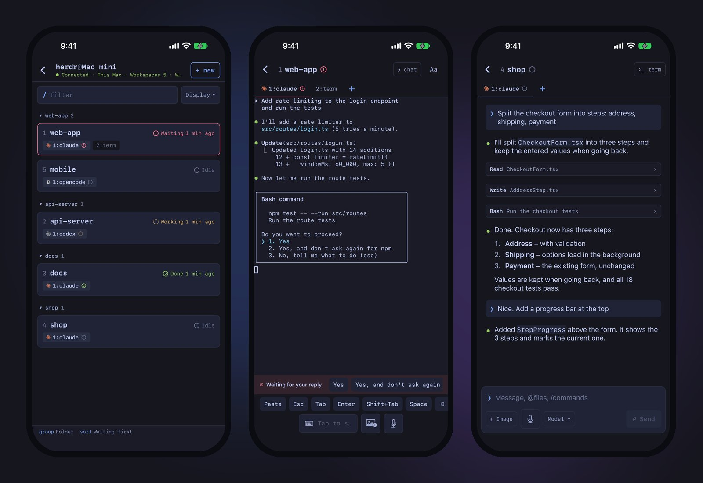
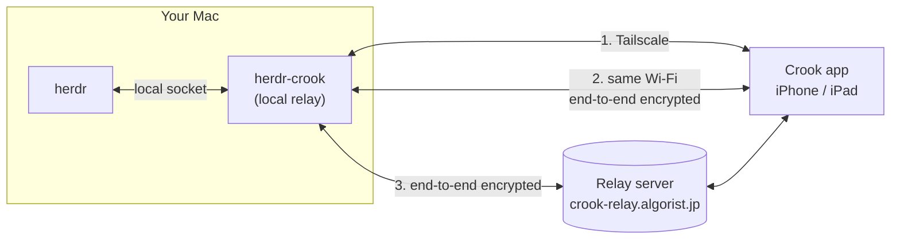

<div align="center">



# herdr-crook

**The Herdr plugin for [Crook](https://crook.algorist.jp) — see your AI coding agents on iPhone and iPad, and answer them with one tap.**

[](https://github.com/algorist-dev/herdr-crook/releases)
[](LICENSE)
[](https://herdr.dev)
[](https://nodejs.org)
[](#requirements)
[](https://apps.apple.com/app/id6832110600)

English | [日本語](README.ja.md)

</div>

> [!IMPORTANT]
> This plugin is the Mac side of **Crook for Herdr**, an iPhone and iPad app. You need the app to use it.
> Get it on the [App Store](https://apps.apple.com/app/id6832110600). See [crook.algorist.jp](https://crook.algorist.jp) for more.

<p align="center"></p>

## What you get

- **Who needs you comes first** — every agent in Herdr on your Mac, ordered waiting → done → working → idle, with the same marks as Herdr (● ◐ ✓ ○).
- **Answer in one tap** — when an agent asks for permission, the choices appear as buttons in the app.
- **The real terminal** — the live, colored terminal of any pane, with an extra keys row (esc, tab, arrows, ctrl, ^C).
- **Talk, type, or attach** — read the conversation as chat and send the next instruction by text or voice, with photos and `@files`.
- **Usage at a glance** — context, tokens, 5‑hour and weekly limits and cost.
- **No account, no SSH setup** — pair with a one‑time QR code. Crook connects only to your own Mac.

Works with Claude Code, Codex, OpenCode, GitHub Copilot CLI, Gemini CLI (with an API key), Pi and Hermes, plus any terminal pane in Herdr. Hermes notifies you only when it's waiting for approval; working and done aren't shown.

## Quick start

1. **Install the plugin** on your Mac:

   ```bash
   herdr plugin install algorist-dev/herdr-crook
   ```

2. **Restart Herdr** (`herdr server stop`, then `herdr`). On the first start the plugin starts its local relay (a launchd agent, `jp.algorist.crook`) and adds the `prefix+m` shortcut.
3. **Pair**: in Herdr press `prefix` then `m` (usually `ctrl+b`, `m`) and scan the QR code with the Crook app. The code works once and expires after 5 minutes.

## Updating

The plugin doesn't update itself. When the Crook app says the plugin on your Mac is out of date (or after a new release), run:

```bash
herdr plugin update
```

Then restart Herdr (`herdr server stop`, then `herdr`). When Herdr starts, the plugin moves its local relay to the new code. Restarting stops running agents, so do it at a good stopping point.

## Requirements

- macOS with [Herdr](https://herdr.dev) 0.9 or later
- Node.js 23.6 or later (TypeScript runs directly, no build step)
- The Crook app on iPhone or iPad with iOS 18 or later ([App Store](https://apps.apple.com/app/id6832110600))

> [!TIP]
> **Recommended: [Tailscale](https://tailscale.com/download) (free for personal use)** on your Mac and your iPhone or iPad, signed in to the same account.
> - Connects directly from anywhere — fast, even away from home
> - No time or data limit
> - Doesn't go through the relay server at all
>
> Without Tailscale, Crook connects over the same Wi‑Fi at home, and through the end‑to‑end encrypted relay server when you're away — up to 120 minutes and 200 MB per Mac per day. Enough to try Crook; if you use it away from home every day, use Tailscale. (Tailscale is a separate service, not affiliated with Crook.)

## How it works



The plugin reads your agents through Herdr's local socket and runs a small relay on your Mac. The app connects to it, trying in order:

1. **Tailscale** — the relay listens on your Tailscale IP and only accepts devices of the same Tailscale user.
2. **Same Wi‑Fi** — end‑to‑end encrypted with your Mac's key, which the app gets from the QR code.
3. **Relay server** (`crook-relay.algorist.jp`, run by Algorist on Cloudflare) — forwards end‑to‑end encrypted data it cannot read. Free, limited to 120 minutes and 200 MB per Mac per day (reset at 00:00 UTC).

The Crook app is distributed on the App Store and the relay server is operated by Algorist. This repository contains the Mac plugin only.

## Privacy and security

| Where | What |
|---|---|
| **Your paired devices only** | Agent list and status, the terminal of panes you open, the conversation of agents you open, file names for `@` completion, usage numbers, your Herdr theme, and (in the QR code) your Mac's Tailscale / local addresses |
| **Relay server** | Only end‑to‑end encrypted frames it cannot read, the text of background notifications (not kept; see [Notifications](#notifications)), plus per‑Mac daily usage counters and connection counts per IP address for rate limiting. Nothing else is stored |
| **Algorist** | Nothing. No accounts, analytics, ads or tracking — in the plugin and in the app |

- **Pairing**: one‑time codes that expire after 5 minutes. Only hashes of device keys are stored (`~/.config/crook/devices.json`, mode 0600). The relay never listens on `0.0.0.0`.
- **Encryption**: on Wi‑Fi and through the relay server, everything is end‑to‑end encrypted (X25519 + ChaCha20‑Poly1305) with your Mac's key from the QR code.
- **Photos** you send are saved in `~/.config/crook/uploads` (mode 0600) so the agent can read them, and deleted after one week.

Details: [privacy policy](https://crook.algorist.jp/privacy). To report a vulnerability, see [SECURITY.md](SECURITY.md).

## Notifications

While the app is open and connected, it tells you when an agent is waiting for you or has finished. When the app is in the background, notifications come through the Crook relay server, with no Apple key needed on your Mac. By default they arrive only when you're away from your Mac (no keyboard or mouse input for 3 minutes, or the Mac is locked); you can change this in the app.

The notification text (workspace and conversation title, and the choices offered) passes through the relay server and Apple. The relay server doesn't keep it. Terminal content is not sent.

## Commands

Run from the plugin folder (`herdr plugin list` shows where it is installed):

```bash
node src/cli.ts status     # is the relay running?
node src/cli.ts devices    # paired devices
node src/cli.ts revoke ID  # remove a device
node src/cli.ts uninstall  # stop the relay and remove the launchd agent
```

Optional, for Claude Code: `node src/cli.ts statusline-install` adds one line to `~/.claude/statusline.sh` (a backup is kept as `.bak-crook`) so the app can show exact context % and 5‑hour / weekly limits.

| Environment variable | Effect |
|---|---|
| `CROOK_RELAY_SERVER=off` | Never use the relay server (Tailscale and same Wi‑Fi only) |

## Troubleshooting

<details>
<summary><b>The app can't connect to my Mac</b></summary>

Make sure Herdr is running and `node src/cli.ts status` says the relay is running. The app tries Tailscale, then the same Wi‑Fi, then the relay server. If you paired before the relay server existed, scan a new QR code once so the app gets your Mac's key.
</details>

<details>
<summary><b>The QR code doesn't work</b></summary>

Each code works once and expires after 5 minutes. Press `prefix` then `m` again for a new one.
</details>

<details>
<summary><b>The plugin doesn't start after installing</b></summary>

Check `node --version` — Node.js 23.6 or later is required (installation stops with a message on older versions). Then restart Herdr (`herdr server stop`, then `herdr`).
</details>

<details>
<summary><b>How do I remove everything?</b></summary>

Run `node src/cli.ts uninstall`, then `herdr plugin uninstall algorist.crook`. Your pairing data is in `~/.config/crook`; delete that folder to remove it too.
</details>

More help: [crook.algorist.jp/support](https://crook.algorist.jp/support) · [open an issue](https://github.com/algorist-dev/herdr-crook/issues/new/choose)

## FAQ

**Is it free?** Yes. The plugin is MIT‑licensed and the app is free, with no account and no in‑app purchases.

**Is Crook made by the Herdr project?** No. Crook is made by [Algorist](https://algorist.jp/) and is not affiliated with the Herdr project.

**Can Algorist see my code or conversations?** No. Data goes only between your Mac and your paired devices. Through the relay server it is end‑to‑end encrypted, so the relay cannot read it. The exception is the short text of background notifications (workspace and conversation title, and the choices offered), which passes through the relay server and Apple and is not kept.

**Do I need Tailscale?** It's not required, but we recommend it. With Tailscale (free for personal use), Crook connects directly from anywhere with no time or data limit. Without it, Crook uses the same Wi‑Fi at home and the end‑to‑end encrypted relay server when you're away, up to 120 minutes and 200 MB per Mac per day.

**Can I use it away from home?** Yes. With Tailscale (recommended), directly and with no limit. Without it, through the relay server within the daily limit.

**Does it work with Linux or Windows?** Not yet — the plugin uses launchd and is tested on macOS only.

## Development

```bash
npm ci
npm test
npm run typecheck
```

See [CONTRIBUTING.md](CONTRIBUTING.md). Changes are listed in [CHANGELOG.md](CHANGELOG.md).

## License

[MIT](LICENSE) © Algorist

## Support development

Crook is free. If it saves you time, you can support development on [Buy Me a Coffee](https://buymeacoffee.com/algorist).
